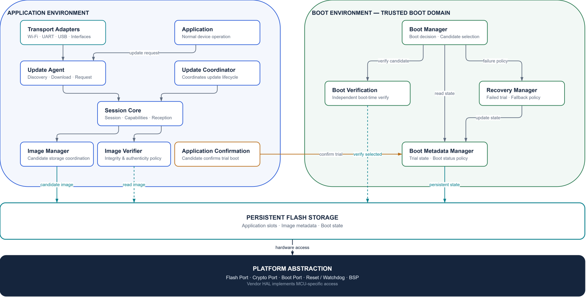
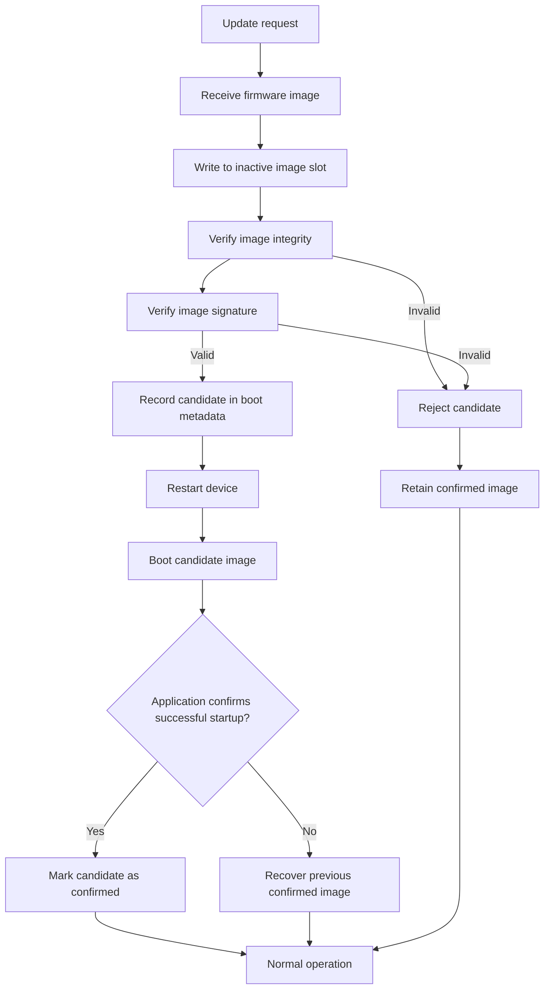

# RP2350 Secure OTA System

A firmware update system for the RP2350 (Raspberry Pi Pico 2W), developed in Rust.

This project investigates the architecture and implementation of a secure OTA update mechanism, with emphasis on firmware image validation, flash memory management, boot control, and recovery from interrupted updates.

The initial development focuses on the boot process and storage architecture before integrating the complete wireless update pipeline. 

To ensure fault tolerance and secure image selection, the system enforces a strict separation between the update delivery mechanisms and the critical boot validation path. The following structural topology illustrates these trust boundaries and component responsibilities:



## Project Objectives

The system is being designed around the following requirements:

- **Image integrity:** detect corrupted or incomplete firmware images before execution.
- **Image authenticity:** verify that firmware originates from a trusted signing authority.
- **Update recovery:** preserve a bootable firmware image if an update is interrupted.
- **A/B image management:** write candidate firmware to an inactive storage region without overwriting the currently confirmed image.
- **Controlled boot selection:** distinguish between confirmed and candidate images, including the handling of unsuccessful trial boots.
- **Hardware security:** evaluate the security mechanisms available on the RP2350 and their applicability to the boot architecture.

These objectives will guide the architectural decisions and implementation. Their guarantees will be established through hardware-level validation and fault-injection testing.

## Engineering Approach

Development is organized around architecture, implementation, and verification.

1. **Requirements and constraints:** identify memory, flash, boot, security, and recovery constraints imposed by the RP2350 platform.
2. **System architecture:** define component responsibilities, boot sequence, image lifecycle, and persistent state.
3. **Architecture Decision Records:** document design alternatives, trade-offs, and selected approaches.
4. **Implementation and verification:** implement individual mechanisms and validate their behavior on hardware.

Architecture decisions are maintained in:

```text
docs/adr/
```

## Update Lifecycle

The following diagram describes the intended update sequence, from image reception to boot confirmation or recovery.



Image integrity and authenticity are treated as separate verification steps. Integrity checking detects unintended modifications, while signature verification establishes whether the image was authorized by a trusted signing key.

The boot metadata is part of the update mechanism: it must allow the boot stage to distinguish a confirmed image from an image undergoing trial execution.

## Boot Architecture

The boot sequence is based on the RP2350 startup process and the bootloader responsibilities defined by the project.

```text
RP2350 Boot ROM
       |
       v
Stage 2 Bootloader
       |
       v
Boot Metadata Evaluation
       |
       v
Firmware Image Selection
       |
       +------ Confirmed image
       |
       +------ Candidate image (trial boot)
       |
       v
Firmware Execution
```

The update path and boot path have different responsibilities.

The update path receives and stores a candidate image, performs the required validation, and updates persistent boot metadata. The boot path evaluates that metadata and determines which image is eligible for execution.

This separation is intended to keep update transport and image delivery independent from boot selection.

## Planned Capabilities

- Dual-image storage and candidate image management.
- Persistent boot metadata and image state tracking.
- SHA-256 image digest verification.
- Digital signature verification.
- Trial boot and application confirmation.
- Recovery to the previously confirmed image.
- WiFi-based firmware delivery.
- Use of the RP2350 hardware SHA-256 accelerator.
- Evaluation of OTP-based rollback protection.

## Platform and Toolchain

| Component | Technology |
|---|---|
| MCU | RP2350 |
| Development board | Raspberry Pi Pico 2W |
| Language | Rust (`no_std`) |
| Async runtime | Embassy |
| Logging | `defmt` / RTT |
| Build system | Cargo |

## Repository Structure

```text
.
├── src/                # Firmware source code
├── docs/
│   └── adr/            # Architecture Decision Records
├── memory.x            # Linker script
├── Cargo.toml
└── README.md
```

## Development Status

**Current phase: architecture and platform investigation.**

The initial work is focused on:

- Understanding the RP2350 boot process and available boot mechanisms.
- Establishing the application and bootloader memory layout.
- Evaluating flash storage constraints for an A/B image arrangement.
- Defining the persistent metadata required for image selection and recovery.
- Investigating the available hardware support for cryptographic operations.

The complete OTA workflow is not yet implemented. The architecture and its recovery guarantees will be refined as platform constraints are verified.

## Future Development

The next development steps include:

- Finalizing the image storage and boot metadata contracts.
- Implementing the image verification pipeline.
- Developing the firmware signing toolchain.
- Integrating WiFi-based image transfer.
- Implementing trial boot, confirmation, and rollback.
- Testing interrupted flash operations and power-loss recovery.
- Evaluating OTP-based anti-rollback mechanisms.

## License

MIT / Apache-2.0 (to be determined).
