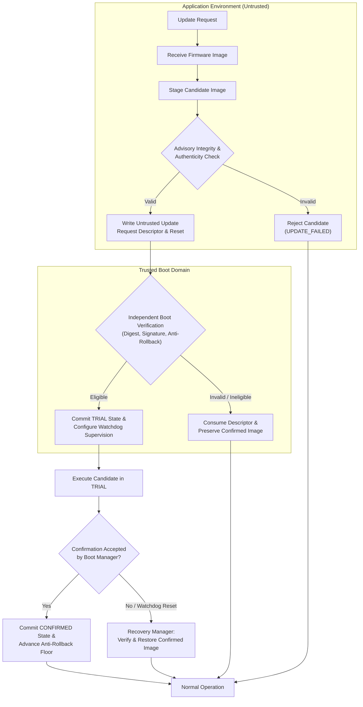
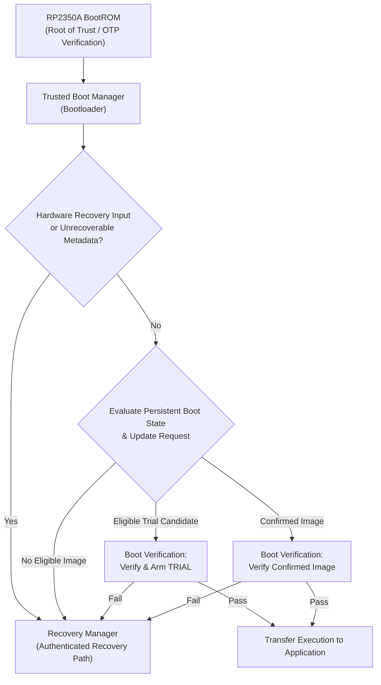

# RP2350 Secure OTA System

A portable, fault-tolerant **Secure Over-The-Air (OTA) firmware update and trusted boot architecture** written in **Embedded Rust (`no_std`)**, with an initial reference implementation targeting the **Raspberry Pi RP2350A** (Pico 2 W) and the **Embassy** async runtime.

This repository prioritizes architectural rigor, hardware-independent verifiability, and power-loss resilience: core update policies and boot state machines are decoupled from silicon-specific drivers behind explicit trait boundaries, enabling full **host-based verification** before on-target bring-up.

---

## Technical Design Specification & ADRs

System requirements, threat model, trust boundaries, dual-state update lifecycle, storage invariants (XIP safety, atomic metadata transitions, 3-image capacity trade-offs), and platform constraints are formally specified in the engineering documentation:

- **Technical Design Specification:** [`docs/TECHNICAL_DESIGN_SPECIFICATION_V1.pdf`](docs/TECHNICAL_DESIGN_SPECIFICATION_V1.pdf)
- **Architecture Decision Records (ADRs):** [`docs/adr/`](docs/adr/) — tracks open and resolved decisions across Security (`SEC-ADR`), Architecture (`ARCH-ADR`), Storage (`STO-ADR`), and RP2350A Platform (`PLT-ADR`).

---

## System Architecture

The architecture enforces a strict trust boundary between the **Application Environment** (untrusted update delivery, staging, and health reporting) and the **Trusted Boot Domain** (independent cryptographic verification, boot selection, trial supervision, and recovery).

<!-- Replace with the updated architecture diagram path once exported -->


### Architectural Layering & Host-First Portability

Core domain logic is kept strictly independent of the target MCU, flash geometry, and transport stack through trait-based hardware abstraction:

- **Core Logic (`boot-core`, `update-core`, `boot-contracts`):** Pure `#![no_std]` state machines, verification policies, and lifecycle invariants. Buildable and testable on the host via `cargo test` using deterministic mocks and fault-injection harnesses.
- **System Ports (`system-ports`):** Explicit trait boundaries aligned with `embedded-hal` / PAL patterns for non-volatile storage (`Flash Port`), cryptography (`Crypto Port`), reset/watchdog supervision (`System Control & Recovery Port`), and transport (`Transport Port`).
- **Platform Implementation (`platform-rp2350`):** Silicon-specific drivers leveraging RP2350A peripherals, PAC/HAL abstractions, Embassy async executors, and RAM-resident XIP-safe flash routines.

---

## Core Design Invariants

- **Independent Boot Verification:** Writing or validating an image in the Application Environment never authorizes execution; the Trusted Boot Domain independently verifies integrity, authenticity, compatibility, and anti-rollback eligibility at boot.
- **Preservation of Eligible Firmware:** Candidate reception and staging must never overwrite the confirmed fallback image or an active trial image.
- **Recoverable Persistent Transitions:** Boot metadata updates are designed to tolerate power loss across erase, program, and commit boundaries without exposing torn state.
- **Bounded Trial Execution & Rollback:** Newly activated candidates run under supervised trial execution (`TRIAL`) and only become `CONFIRMED` upon an authorized persistent commit; failed trials automatically recover to the previously confirmed image.
- **Monotonic Anti-Rollback:** Security version floors advance only after confirmation and are evaluated for RP2350A OTP-backed persistence.

---

## Update Lifecycle

The update flow separates untrusted application-level staging from trusted boot-time authorization. Rejecting a candidate at any stage preserves the previously confirmed firmware.



---

## Boot Sequence (RP2350A)

Unlike the RP2040, the RP2350A BootROM natively initializes QSPI/XIP flash and provides hardware-backed Secure Boot and OTP primitives. The Trusted Boot Manager builds directly on top of the RP2350A BootROM startup path:



---

## Platform & Toolchain

| Component | Technology / Specification |
| :--- | :--- |
| **Microcontroller** | Raspberry Pi RP2350A (Dual-core **ARM Cortex-M33** / **Hazard3 RISC-V**) |
| **Reference Board** | Raspberry Pi Pico 2 W (520 KB SRAM, 4 MB QSPI Flash, 8 KB OTP, CYW43439 Wi-Fi) |
| **Language** | Rust (`#![no_std]`) |
| **Async Runtime** | Embassy (`embassy-executor`, `embassy-sync`, `embassy-time`, `embassy-net`, `embassy-rp`) |
| **Hardware Abstraction** | `embedded-hal` traits, PACs, custom `system-ports` |
| **Debugging & Logging** | SWD, `probe-rs`, `defmt` / RTT |
| **Verification** | Host-based unit & fault-injection test suites (`cargo test`) + on-target validation |

---

## Repository Structure

The workspace separates firmware entry points, core logic, platform implementations, and supporting tools.

<details>
<summary><b>📂 Repository workspace</b></summary>

```text
rp2350-secure-ota-system/
├── Cargo.toml
├── .cargo/
│   └── config.toml
├── firmware/
│   ├── application/            # Pico 2 W application & OTA client
│   └── bootloader/             # Trusted Boot Domain entry point
├── crates/
│   ├── boot-core/              # Platform-independent boot policy & state machine 
│   ├── update-core/            # Update coordinator & session core 
│   ├── boot-contracts/         # Shared manifests, descriptors & metadata schemas
│   ├── system-ports/           # Hardware abstraction traits (Flash, Crypto, Reset, Transport)
│   ├── platform-rp2350/        # RP2350A drivers, XIP-safe flash routines & OTP bindings
│   └── transport/              # Transport adapters (CYW43439 Wi-Fi / UART)
├── tools/
│   └── firmware-signer/        # Host CLI for deterministic image manifest & signature generation
├── tests/                      # Host-based integration & power-loss fault-injection suites
└── docs/
    ├── adr/                    # Formal Architecture Decision Records
    └── TECHNICAL_DESIGN_SPECIFICATION_V1.pdf
```

</details>

---

## Engineering Roadmap & Milestones

Development follows a disciplined, specification-first workflow (Requirements $\rightarrow$ Architecture $\rightarrow$ ADRs $\rightarrow$ Host Verification $\rightarrow$ Silicon Bring-up):

- [x] **Phase 1 — Architecture & Specification:** System requirements, threat model, trust boundaries, dual-state lifecycle, storage invariants, and RP2350A platform constraints (TDS v0.1).
- [x] **Phase 2 — Workspace & Contracts:** Cargo workspace scaffolding, `system-ports` trait boundaries, and ADR baseline.
- [ ] **Phase 3 — Host-Verified Core Logic:** Implement `boot-core` and `update-core` state machines with full host-based unit tests and simulated power-loss fault injection.
- [ ] **Phase 4 — RP2350A Storage & Boot Bring-up:** Resolve `STO-ADR` / `PLT-ADR` (BootROM boundary, 4 MB flash partition map, RAM-resident XIP-safe flash routines, and transactional metadata).
- [ ] **Phase 5 — Cryptographic Verification & Anti-Rollback:** Integrate SHA-256 / signature verification (`firmware-signer` + on-target `Boot Verification`) and evaluate RP2350A OTP monotonic counters.
- [ ] **Phase 6 — Wireless OTA Integration:** Integrate `embassy-net` / CYW43439 transport with chunked, XIP-stall-tolerant reception and end-to-end trial/rollback validation on Pico 2 W.

---

## License

Dual-licensed under **MIT** or **Apache-2.0**, at your option (`MIT OR Apache-2.0`).
